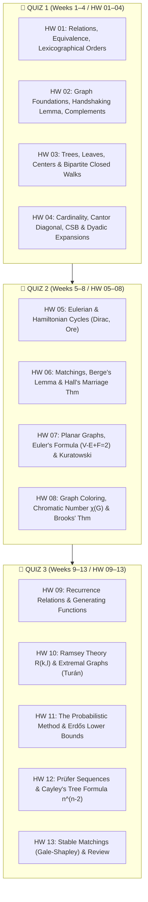

# Bar-Ilan University — Discrete Structures (89-2197)
## Syllabus, Homework & Quiz Mapping Guide

**Lecturer:** Dr. Arnold Filtser  
**Course:** Discrete Structures (מבנים בדידים) — 89-2197  
**Exam Policy:** 3 Term Quizzes ($\approx$ 4 Homeworks / 4 Weeks of Lectures & Recitations each) + Final Exam (Moed A / B).  
**Standard Quiz Format (2026/2027):** 90 minutes. Consists of **5 multiple-choice questions** (single correct answer each, testing Lectures & Recitations, 15 pts each = 75 pts) + **1 open-ended proof question** based directly on the Homework exercises (25 pts, total 100 points). *(Legacy 2025/2026 format: 3 open questions $\times$ 34 pts).*

---

## 🎯 The 3-Tier Quiz Mapping

---

## 📋 Detailed Breakdown of Quiz 1 (HW 01 – HW 04)

### HW 01 — Binary Relations & Order Theory
- **Core Topics:**
  - Reflexive, Irreflexive, Symmetric, Antisymmetric, Asymmetric, Transitive properties.
  - Equivalence Relations & Partition Bi-implication ($A/R$).
  - Partially Ordered Sets (Posets) vs. Total (Linear) Orders.
  - Lexicographic Order on $A^n$: Formal definition and the totality preservation proof.
  - Extreme Elements: Maximal vs. Maximum, Minimal vs. Minimum, Chains and Antichains (Dilworth's Theorem).
  - Poset Duality & Well-Ordered Sets (equivalence to Axiom of Choice).

### HW 02 — Graph Foundations & Invariants
- **Core Topics:**
  - Simple graphs, neighborhoods $N(v)$, and degrees $\deg(v)$.
  - The Handshaking Lemma ($\sum \deg(v) = 2|E|$) and the parity of odd-degree vertices.
  - Degree Sequence Pigeonhole Theorem (degree 0 and degree $n-1$ cannot coexist).
  - Subgraphs: Spanning subgraphs vs. Induced subgraphs $G[S]$.
  - Graph Metric Invariants: Distance $\text{dist}(u,v)$, Girth $g(G)$, Diameter $\operatorname{diam}(G)$.
  - Proof that disconnected graph complement has diameter $\operatorname{diam}(\overline{G}) \le 2$.

### HW 03 — Trees & Bipartite Graphs
- **Core Topics:**
  - The 6 logically equivalent characterizations of trees (connected + $n-1$ edges, unique paths, etc.).
  - Existence of at least two leaves in every non-trivial tree (Handshaking proof).
  - Tree Center: Jordan's Theorem (center has 1 vertex or 2 adjacent vertices) and leaf trimming algorithm.
  - Kőnig's Bipartite Characterization: A graph is bipartite $\iff$ contains no odd cycles.
  - Equivalence of odd cycles and odd cyclic walks (Cycle Extraction by Induction).

### HW 04 — Cardinality, Infinite Sets & Cantor-Schröder-Bernstein
- **Core Topics:**
  - Equinumerosity ($A \sim B$) and cardinal dominance ($|A| \le |B|$).
  - Countable sets ($\aleph_0$) and Cantor pairing function $\mathbb{N} \times \mathbb{N} \sim \mathbb{N}$.
  - The Continuum ($\aleph = 2^{\aleph_0}$) and canonical representations ($\mathcal{P}(\mathbb{N}) \sim \{0, 1\}^\mathbb{N} \sim \mathbb{R}$).
  - Cantor's Diagonal Argument for uncountable sequences.
  - Cantor's Theorem ($|A| < |\mathcal{P}(A)|$) via the diagonal set $D = \{x \mid x \notin f(x)\}$.
  - Cantor-Schröder-Bernstein (CSB) Theorem: Explicit injections $f: A \to B$ and $g: B \to A$.
  - Dedekind-Infinite Characterization: $S$ is infinite $\iff \exists$ injection $f: S \to S$ that is not surjective (proof via orbit $g(n) = f^n(a)$).
  - Resolving dyadic fraction double-expansions ($0.0111\dots_2 = 0.1000\dots_2$) using base 3 or set subtraction.

